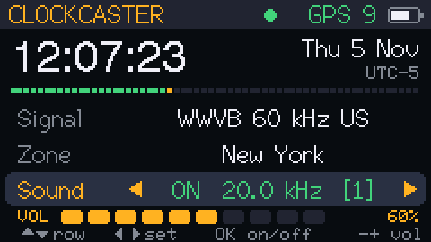

# ClockCaster

**Sync radio-controlled ("atomic") watches and clocks anywhere in the world, from an M5Stack Cardputer-Adv.**

ClockCaster turns a Cardputer-Adv with the Cap LoRa-1262 into a pocket time-signal transmitter. It takes the exact time from the cap's GPS and sends it in the format of the official longwave time stations, so a radio-controlled watch or clock sitting on the Cardputer syncs as if it were in range of the real station.

That means a Japanese-market clock that only knows JJY can sync in the US, a European DCF77 clock can sync in Asia, and a watch inside a building where the real signal never reaches can still sync.

<p align="center">
  
</p>

## Supported signals

| Signal | Carrier | Region | Time carried |
|---|---|---|---|
| **WWVB** | 60 kHz | USA | UTC + US DST flags |
| **DCF77** | 77.5 kHz | Germany / Europe | Local time (CET/CEST by default) |
| **MSF** | 60 kHz | UK | Local time (GMT/BST by default) |
| **JJY 40** | 40 kHz | Japan (east) | Local time (JST by default) |
| **JJY 60** | 60 kHz | Japan (west) | Local time (JST by default) |

## Hardware

- [M5Stack Cardputer-Adv](https://docs.m5stack.com/en/core/Cardputer-Adv)
- [Cap LoRa-1262](https://docs.m5stack.com/en/core/Cardputer_Mesh_Kit) (only its GPS is used; it ships in the Cardputer Mesh Kit)

No soldering or extra parts are needed.

## Install

Download the firmware from the [`firmware`](firmware/) folder (or the Releases page).

- **M5Launcher:** copy `clockcaster_app.bin` to the microSD card, then in M5Launcher choose **SD → clockcaster_app.bin → Install**.
- **USB web flasher / esptool:** flash `clockcaster_full_flash_0x0.bin` at address **0x0**. Hold **G0** while plugging in USB to enter download mode. This replaces anything else on the device, including M5Launcher.

## Use

1. Take the Cardputer near a window or outside until the header shows a green GPS dot and the clock appears.
2. Pick the **Signal** your watch or clock listens for, and a **Zone** (see below).
3. Press **Enter** to start the sound.
4. Lay the watch face-up on the speaker grille and start a manual reception on the watch. A sync usually takes 2–6 minutes.

Once it has a GPS fix, it keeps accurate time on its own internal clock, so you can take it back indoors.

### Controls

| Key | Action |
|---|---|
| `;` `.` (↑ ↓) | Move between rows |
| `,` `/` (← →) | Change the selected setting |
| `Enter`, `Space` or `G0` | Start / stop the sound |
| `-` and `=` / `+` | Volume down / up |

Your Signal, Zone and Volume settings are saved. The sound is always off at power-up.

### Choosing the Zone

- **DCF77, MSF, JJY** carry *local* time, and the receiving clock displays it as-is. Set **Zone** to where you are, such as **New York**, and an imported JJY or DCF77 clock will show your local time with correct DST changes. **Auto** uses the station's home zone.
- **WWVB** always carries UTC; the watch applies its own time-zone setting. Here the Zone only sets the DST flags (Auto = US rules).

There are 22 zones built in, with US, EU, Australian and New Zealand DST rules.

### Multiband watches (G-Shock, Citizen, Seiko, etc.)

These pick the station based on the watch's **home city**. Match the Signal to it: a US city means WWVB, Tokyo means JJY, London means MSF, and Paris or Berlin means DCF77.

## Tested devices

| Device | Signal | Result |
|---|---|---|
| Casio G-Shock GW-M5610 | WWVB | ✅ Synced with the watch sitting next to the speaker |
| Seiko travel alarm clock (Japanese market, JJY only) | JJY | ✅ Synced in the US, showing Eastern time with Zone set to New York |

Got it working (or not) with another watch or clock? Open an issue or PR with the model, the signal and the volume you used.

## How it works

Radio-controlled clocks listen on very low frequencies (40–77.5 kHz), which the Cardputer has no radio for. ClockCaster uses the built-in speaker instead: it plays a tone at **one-third** of the carrier frequency (one-fifth for DCF77), for example 20 kHz for 60 kHz signals. The speaker's voice coil also radiates the tone's harmonic at the real carrier frequency as a weak magnetic field, which the clock's ferrite antenna picks up a few centimeters away.

The tone's level is keyed exactly like the real station, one bit per second, with soft edges so it doesn't click. Time comes from the cap's GPS, re-synced every second.

**Optional loop antenna:** the true carrier is also output on **Grove pin G2**. If the speaker doesn't reach a stubborn watch, connect a few turns of wire through a ~330 Ω resistor from G2 to GND and place the watch inside the loop.

### Tips

- If it won't sync, raise the volume a step and slide or rotate the watch on the grille. Watch antennas are usually near the 9 or 12 o'clock edge of the case.
- The 13–20 kHz tones are barely audible to most adults but may bother pets, so keep sessions short.
- No GPS data at all? Swap `GPS_RX_PIN` and `GPS_TX_PIN` at the top of the source file.

## Build from source

The sketch is `clockcaster/clockcaster.ino`.

**Arduino IDE:** install the *esp32* board package (3.x) and the libraries **M5Cardputer**, **M5Unified**, **M5GFX** and **TinyGPSPlus**. Select the **M5Cardputer** board, then upload.

**arduino-cli:**

```sh
arduino-cli core install esp32:esp32
arduino-cli lib install M5Cardputer M5Unified M5GFX TinyGPSPlus
arduino-cli compile -b esp32:esp32:m5stack_cardputer --output-dir build clockcaster
```

## Responsible use

ClockCaster produces an extremely weak near-field signal meant to reach a watch a few centimeters away. Keep it that way: don't amplify it or attach a large antenna. A stronger transmitter on these frequencies could disrupt other people's clocks and may break radio regulations where you live.

## License

[MIT](LICENSE)
